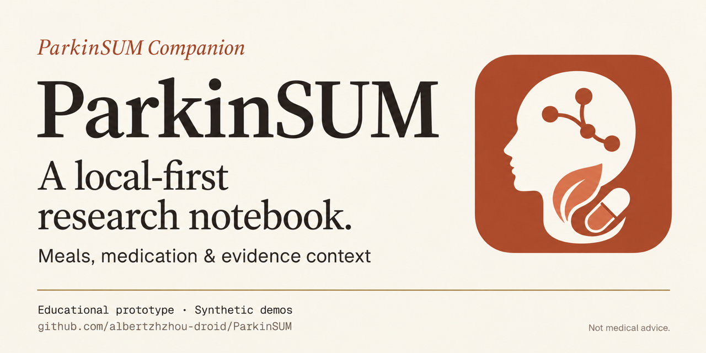
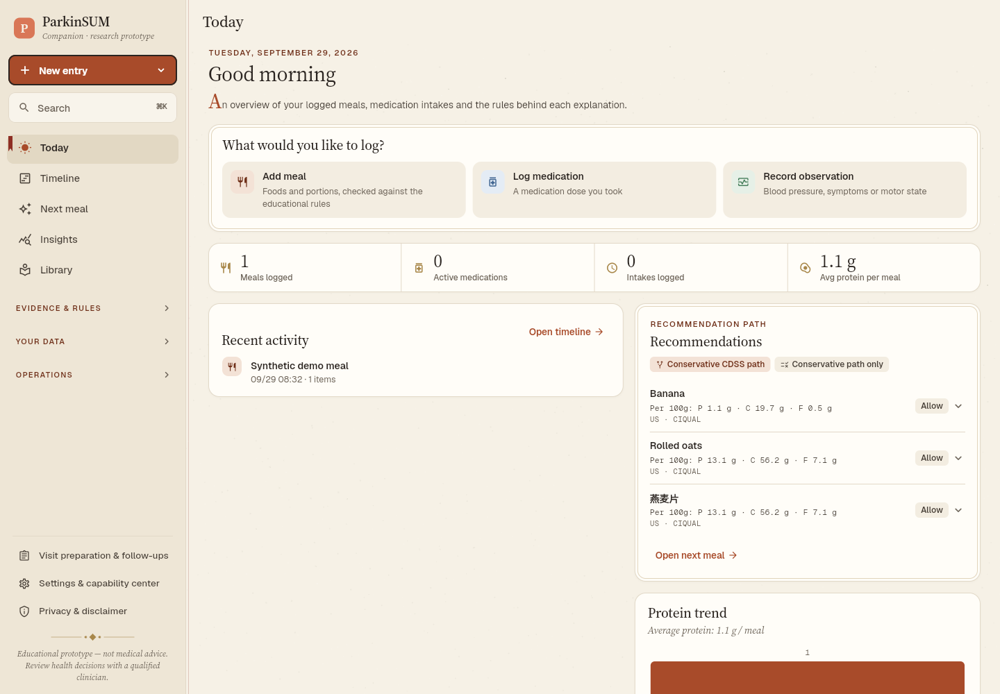
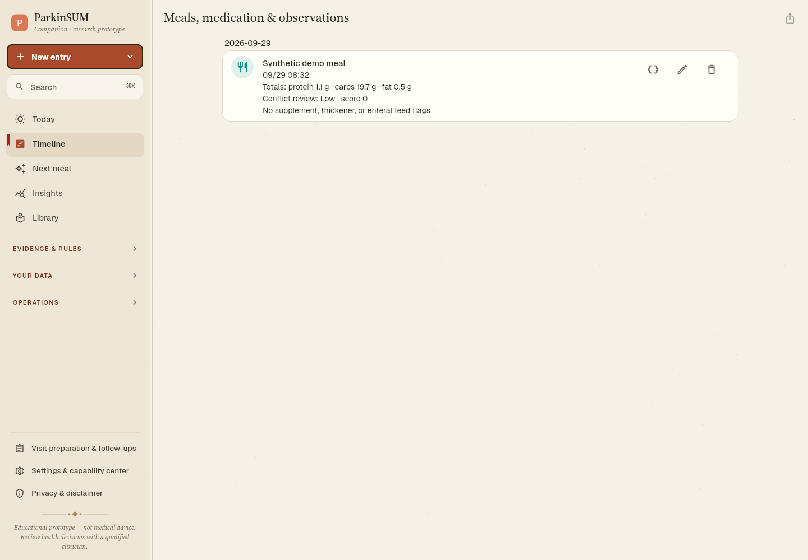
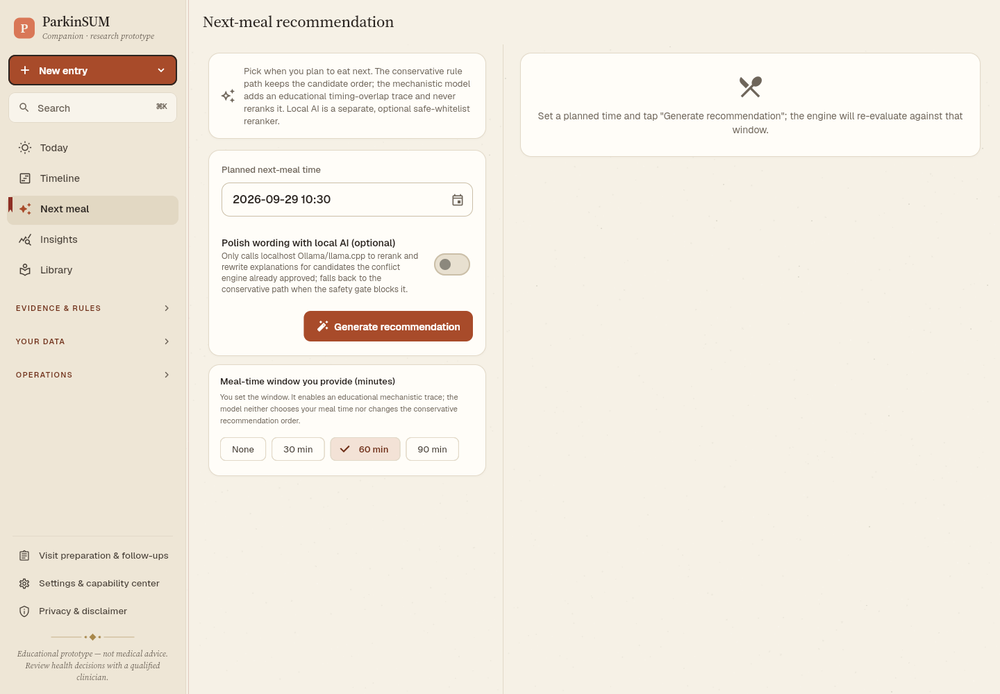
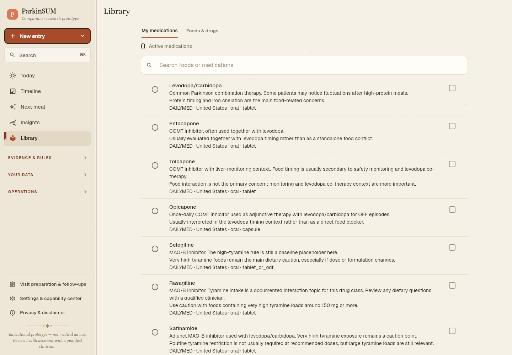
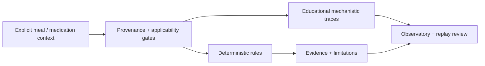

# ParkinSUM Companion

<p align="center">
  
</p>

[Brand assets: icon, logo & GitHub card](docs/media/social-preview.md)

[](https://github.com/albertzhzhou-droid/ParkinSUM/releases/latest)
[](https://github.com/albertzhzhou-droid/ParkinSUM/actions/workflows/ci.yml)


**ParkinSUM explores one question: how might meals, especially protein-rich
ones, interact with the timing of levodopa, a common Parkinson's disease
medication?**

## What you can do in the app

- **Keep a simple log.** Record meals, medication doses and observations in one
  local-first notebook.
- **Check a meal against medication timing.** Educational rules compare a meal
  with the medications you selected and show their reasons, their sources and
  anything that is missing. If a dose or the time it was taken is missing, the
  app says it can't assess the meal yet instead of guessing.
- **Compare next-meal ideas.** Choose a time and see catalog foods listed by
  the rules, with the reasons next to each one.
- **See how a result was computed.** Each result has a "How was this
  computed?" section, and the Algorithm Observatory shows the rules, evidence
  sources and educational model traces in full.

> **Not medical advice.** ParkinSUM is an educational
> production-architecture prototype. It is not a medical device or a clinical
> decision tool, and its model is not clinically calibrated. Do not use it for
> diagnosis, treatment, medication timing, dose selection, dietary decisions,
> clinical decision-making, patient care or emergencies; take health questions
> to a qualified clinician. Public demos use synthetic or sample data only.
> [What the evidence does and does not show](docs/EVIDENCE_SCOPE.md) ·
> [Full disclaimer](DISCLAIMER.md)

[Project site](https://parkinsum.com) ·
[Showcase](https://albertzhzhou-droid.github.io/ParkinSUM/site/) ·
[Documentation](docs/README.md) ·
[Capabilities & limitations](docs/CAPABILITY_MATRIX.md) ·
[Verification guide](docs/PUBLIC_VERIFICATION.md) ·
[Changelog](CHANGELOG.md)

## The Paper workspace

| Chapter | What to explore |
| --- | --- |
| **Today** | A single composer for a meal, medication intake, or observation; recent activity and chapter previews. |
| **Timeline** | Logged entries, record details, editing, and explicit export actions. |
| **Next meal** | A time you choose, foods compared by the rules, and the reasons and limits beside them. |
| **Insights** | Descriptive views of recorded entries, including logging rhythm and protein distribution. |
| **Library** | Selected medications and the food/medication catalog, with source context. |

Use **⌘K / Ctrl+K** or the sidebar groups to open the Algorithm Observatory,
rule audit trail, synthetic rule test workbench, data tools, and diagnostics.
Local AI settings live under **Settings → Advanced**.

<p align="center">
  
  <br><sub>Today: one entry composer, recent activity, descriptive figures, and the rule-based candidate preview.</sub>
</p>

<table>
  <tr>
    <td width="50%"><br><sub>Timeline: the saved synthetic meal and its record controls.</sub></td>
    <td width="50%"><br><sub>Next meal: comparison settings before generating a result.</sub></td>
  </tr>
  <tr>
    <td colspan="2"><br><sub>Library: catalog source context with no medications selected; catalog text is not individualized guidance.</sub></td>
  </tr>
</table>

Synthetic browser captures from 29 September 2026; see the
[capture record](docs/assets/screenshots/README.md).

## How it works

The conflict engine is **deterministic and evidence-linked**, and no LLM sits
inside it. Each explanation shows the source references, the fields used, the
inputs that were missing or uncertain, and its limitations.

- **Explicit context.** Medication interpretation needs supported,
  catalog-backed context and explicit units. A missing nutrient stays unknown
  rather than becoming `0 g`, and a missing dose or medication time leaves the
  meal unassessed.
- **Educational model traces.** Literature-informed gastric-residence,
  absorption-opportunity and amino-acid competition traces are sensitivity
  views. They never choose meal times or reorder candidates (`trace_only`).
- **Bounded optional AI.** With explicit consent, a model on your own computer
  (loopback only) may only reorder rule-screened, non-`BLOCK` candidates or
  reword existing copy. It cannot change medication data, conflict
  classifications, scores, rules, evidence or safety gates.
- **Replayable research.** Synthetic cases, replay artifacts, source-quality
  reports and independent contract checks support review.

See the [rule-engine contract](docs/RULE_ENGINE.md),
[mechanistic model](docs/CONFLICT_ENGINE_MODEL.md),
[Observatory design](docs/design/ADR_ALGORITHM_OBSERVATORY.md),
[synthetic rule workbench](docs/RULE_TEST_WORKBENCH.md), and
[evidence scope](docs/EVIDENCE_SCOPE.md).



## Run locally

Use the Flutter version pinned in [CI](.github/workflows/ci.yml), a compatible
Dart SDK (`>=3.11.0 <4.0.0`), and Node.js/npm for repository checks.

```sh
git clone https://github.com/albertzhzhou-droid/ParkinSUM.git
cd ParkinSUM
flutter pub get
flutter run -d chrome --dart-define=PARKINSUM_BACKEND=local
```

Complete onboarding using a fresh synthetic profile. Open **Today** for the
workspace or **Algorithm Observatory** for fixed, non-personal scenarios.
Firebase-backed paths are retained for internal operator validation and require
separate project access; they are not needed for the local demo.

For the static showcase, serve the repository root and open `/docs/site/`:

```sh
python3 -m http.server 8000
```

## Verify a change

```sh
npm ci
dart format --output=none --set-exit-if-changed lib test tool
flutter analyze
flutter test
npm run public:preflight
npm run rules:contract
```

Inspect and run the broader synthetic governance checks as needed:

```sh
npm run verify:all -- --list
npm run verify:all
npm run mechanistic:replay
npm run source:quality
```

The [public verification guide](docs/PUBLIC_VERIFICATION.md) documents command
scope, prerequisites, expected outputs, and failure meaning; CI and the
[iteration timeline](docs/APP_EVOLUTION_TIMELINE.md) record actual results.

## Data and privacy

Public screenshots, tests, examples, and walkthroughs must use synthetic data
and exclude real account identifiers and health information. Records you enter
and the files you export can contain sensitive health information, so never
publish them, or any credentials or operator logs. Read the
[disclaimer](DISCLAIMER.md), [public demo boundary](docs/PUBLIC_DEMO_BOUNDARY.md),
[source access policy](docs/SOURCE_ACCESS_AND_LICENSES.md), and
[security policy](SECURITY.md) before presenting or reusing the project.

## v0.2.0 — September 2026 update

The [v0.2.0 release](https://github.com/albertzhzhou-droid/ParkinSUM/releases/tag/v0.2.0)
brings the app, research tools, and public showcase together around the
**Paper** interface: warm paper tones, serif headings, legible opaque surfaces,
and restrained motion that respects reduced motion settings. The app bundles
Source Serif 4, Geist, and Geist Mono under SIL OFL licenses; it does not
download these fonts at runtime.

| Area | What changed |
| --- | --- |
| **Paper workspace** | Five chapters, one entry composer, responsive navigation, and a shared command palette. |
| **Algorithm Observatory** | Fixed synthetic scenarios, production-derived traces, configuration identities, explanation trees, and saved replay capsules. |
| **Medication and food context** | Explicit dose-unit handling, source and version provenance, missingness, and bounded food-rank sensitivity. |
| **Owner-controlled records** | Observation entries, portable packages, recoverable history, and selected records for visit-preparation summaries. |
| **Research workbench** | Synthetic rule testing, development-only FHIR/CQL/CDS Hooks experiments, and source/license review records. |

The [capability matrix](docs/CAPABILITY_MATRIX.md) distinguishes implemented,
fixture-tested, report-only, and future work; the
[evidence scope](docs/EVIDENCE_SCOPE.md) lists what each area's evidence does
not establish. The [v0.2.0 release notes](docs/release/v0.2.0-notes.md) record
this source and release-metadata publication, its verification, and remaining
limits. Flutter app metadata remains
`0.2.0+2`; this release does not distribute an app binary.

## Documentation and contributions

| Entry point | Purpose |
| --- | --- |
| [Documentation index](docs/README.md) | Find app, research, evidence, and release documents. |
| [Evidence scope](docs/EVIDENCE_SCOPE.md) | What screenshots, fixtures, checks, and releases do and do not establish. |
| [Evidence demo guide](docs/EVIDENCE_AND_TRACEABILITY_DEMO_GUIDE.md) | Review the synthetic evidence chain. |
| [Architecture](docs/ARCHITECTURE.md) | UI, state, local data, rules, and provenance layers. |
| [Bibliography](Bibliographies.md) | Sources behind educational assumptions. |
| [Contribution guide](CONTRIBUTING.md) | Scope a change and preserve public boundaries. |
| [Roadmap](ROADMAP.md) | Planned work and unresolved capabilities. |
| [Project wiki](https://albertzhzhou-droid.github.io/ParkinSUM/wiki/) | A short visual guide and reviewer route. |

Useful contributions improve source provenance, explicit missingness,
explanation clarity, synthetic regression cases, accessibility, localization,
and reproducibility. Start with a scoped item from the
[contribution backlog](docs/contribution-backlog.md); do not add medical claims
or treat unfinished research as a shipped capability.

## Repository map

| Path | Purpose |
| --- | --- |
| `lib/features/` | Paper chapters, evidence tools, record flows, and diagnostics. |
| `lib/core/` | Shared state, local storage, configuration, localization, and theme. |
| `lib/domain/` | Entities, deterministic rules, models, and evidence contracts. |
| `lib/data/` | Repository adapters, source importers, and persistence. |
| `config/` | Versioned governance, schema, source, and release inventories. |
| `test/` / `tool/` | Synthetic tests, replay runners, verification, and operator tools. |
| `docs/` | Public documentation, research boundaries, and iteration history. |

## Releases and contact

The latest release as of 2026-09-29 is
[v0.2.0](https://github.com/albertzhzhou-droid/ParkinSUM/releases/tag/v0.2.0).
Read its [release notes](docs/release/v0.2.0-notes.md) and
[changelog](CHANGELOG.md), or use GitHub's
[Latest release](https://github.com/albertzhzhou-droid/ParkinSUM/releases/latest)
link. It publishes source and the scoped
[npm release-metadata package](packages/npm/README.md), with no app binary.
Historical [v0.2.0-beta notes](docs/release/v0.2.0-beta-notes.md) remain available.

Public contact: **parkinsumservice@gmail.com**.

To cite ParkinSUM, see [CITATION.cff](CITATION.cff) and the
[evidence scope](docs/EVIDENCE_SCOPE.md#citing-and-reuse).
